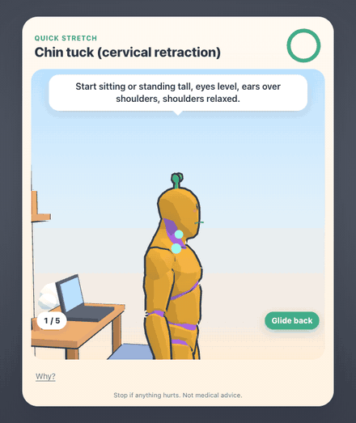

# stretchbud

A tiny macOS menu bar app that notices how long you have been at the keyboard and pulls you out for a short, specific habit: a neck stretch, ten squats, a glass of water, a five-minute walk. A 3D figure shows exactly what to do.

It is mandatory but kind. It waits for a natural pause instead of cutting you off mid-sentence, warns you 30 seconds ahead, lets you say "Later" twice, and never interrupts a call.



## Why another break reminder

Most break apps fire on a timer and show a line of text. People click "skip" without thinking. stretchbud is built around four things the others do not do together:

- **It picks the moment.** A break becomes due on a timer, then waits up to 5 minutes for a breakpoint: you switched apps, you paused for 20 seconds, or you are waiting on a Claude Code turn. If you stepped away for 5 minutes, that counts as a break and nothing pops up.
- **It never interrupts a call.** If any app is using the camera or microphone, breaks wait.
- **It shows the movement.** A human-proportioned figure does the exercise with the working joints highlighted, from the camera angle where the movement reads best.
- **The content is sourced.** Every exercise has its steps, a caution list and an honest evidence label. Each one is backed by a source or is a labelled variation of a sourced exercise; anything else is not in the app.

## What a day looks like

Timers count active time only (input in the last 60 seconds), so reading a long page or stepping away does not rack up "sitting time".

| Every | You get | Length |
|---|---|---|
| 30 active min | Quick stretch: one posture item (neck, shoulders, back) and one small one (wrists, eyes, breathing, reset) | about 1 min |
| 60 active min | Move break: squats, push-ups or calf raises, plus a posture item | 2 to 3 min |
| 90 active min | A glass of water, added to the next break | 25 s |
| Twice a day | A 5-minute walk (after 2 h and 5 h of active time) | 5 min |
| Twice a day | A VO2 challenge: a short vigorous burst, once you have been active for an hour | 2 to 3 min |

Strength moves come in ladders (wall push-up, desk push-up, slow desk push-up). Harder variations unlock after you complete the easier ones a few times.

All of this is in `~/Library/Application Support/Stretchbud/config.json`.

## Install

Built and tested on macOS 14 (Apple Silicon). Requires the Xcode Command Line Tools (`xcode-select --install`).

```sh
git clone https://github.com/MateoRomano02/stretchbud.git
cd stretchbud
make install
```

This builds the app with `swiftc`, installs it in `~/.local`, and starts it at login with a LaunchAgent. Look for 🌱 in the menu bar. It asks for no permissions.

```sh
stretchbud now              # take a break now
stretchbud end              # close the current break
stretchbud demo             # try a break without waiting
stretchbud pause 1h         # also: 90m, tomorrow (until 06:00), off (until you resume)
stretchbud resume
stretchbud status
make uninstall              # stop and remove it (your data folder is kept)
```

The same pauses are one click away in the 🌱 menu: Pause 1 hour, Pause until tomorrow, Pause until I resume, Resume.

Try the figure in a browser without installing anything: open `web/index.html?demo`.

## Getting out

A break covers your screens with a dimmed overlay. You can always leave:

- hold **Esc** for 3 seconds,
- click **skip** (appears after 20 seconds) or **Later** (first 15 seconds, twice per break),
- run `stretchbud end`,
- or wait: a watchdog closes every break shortly after its time is up.

It does not block Cmd-Tab, Force Quit or anything else in macOS.

## Claude Code

Waiting on an agent is the best moment for a break. With the optional hooks installed, stretchbud knows when a Claude Code turn is running, and if you are also idle it uses that window, up to 10 minutes early.

```sh
make claude-hooks          # merges 5 async hooks into ~/.claude/settings.json (backs it up first)
make claude-hooks-remove
```

The hooks run in the background and cannot slow Claude down. They record the event name and session id. The prompt text is never read or stored.

## Privacy

stretchbud reads four things: seconds since your last input, which app is in front (bundle id only), whether a camera or microphone is in use, and whether the screen is locked. It never sees keystrokes, window titles, screen contents or what you type to Claude. Everything stays in `~/Library/Application Support/Stretchbud`. There is no network code and no telemetry. Delete that folder to erase everything.

## What the evidence says, honestly

The full research with sources is in [`research/`](research/), including three adversarial verification passes (`07`, `08`, `10`) that tried to refute each claim against its primary source.

- **Short breaks help how you feel, not how much you produce.** A meta-analysis of 22 samples (N=2,335) found micro-breaks improve vigor (d=0.36) and reduce fatigue (d=0.35), with no significant effect on performance (Albulescu 2022).
- **Walking beats standing.** In lab trials, 2 minutes of walking every 20 minutes lowered post-meal glucose by 24 to 30% (Dunstan 2012, n=19), and 5 minutes every 30 minutes was the only dose that lowered glucose in a second trial (Diaz 2023, n=11). These are one-day lab studies.
- **For neck and shoulders, strengthening beats stretching**, and most trials enrolled people who already had pain. No trial shows a single desk stretch prevents pain.
- **20-20-20 for the eyes is weak.** A controlled trial (Johnson & Rosenfield 2023, n=30) found 20-second breaks did not reduce eye strain. It stays as a cheap pause that prompts blinking, labelled as weak.
- **VO2 bursts need weeks.** In small trials of inactive young adults, a few short hard stair or cycling bursts a day for 6 to 8 weeks improved peak oxygen uptake modestly. One real-world 12-week trial in 69 adults with type 2 diabetes found no change. One burst does not change your fitness, and desk-only bursts have not been tested.
- **Water reminders are optional.** "8 glasses a day" has no evidence behind it. EFSA's adequate intake is 2.0 L (women) and 2.5 L (men) of total water a day, food included.

## Safety

This is not medical advice. Stop any exercise that causes pain, dizziness, numbness or tingling. Ask a doctor before the vigorous bursts if you have a heart, kidney or metabolic condition, high blood pressure, or symptoms during exercise. Set `vo2PerDay` to 0 to turn them off. Each exercise lists its own cautions under "Why?".

## How it is built

- `Sources/Core`: break timing, routine picking and Claude session tracking. Pure Swift, no AppKit, covered by `make test`.
- `Sources/App`: activity probes, the overlay (one panel per screen, a `WKWebView` on the main one), the menu bar item and local storage.
- `web/`: three.js scene, keyframed exercises (`poses.js`), and `exercises.js`, generated by `scripts/build_content.py` from the verified catalog in `research/`. An exercise ships only if it passed verification and has an animation.

## Credits

- Character: [Quaternius](https://quaternius.com) Universal Animation Library, CC0.
- 3D: [three.js](https://threejs.org), MIT.

## License

MIT. See [LICENSE](LICENSE).
